<p align="center">
  
</p>

# B站 400+ 收藏的守岸人桌宠

**鸣潮 · 守岸人桌宠｜DeepSeek Harness 完整版插件**

**现在，守岸人来陪你了。**

**v1.2.0**：定时检查新版，无声更新气泡常驻；点击“更新并重启守岸人”即可下载程序更新、保留当前配置和素材并重启。可选“今日不再提醒”；下载或安装中断可恢复。 [更新与恢复](desktop/docs/UPDATES.md)

把《鸣潮》的守岸人带到桌面，陪你工作，也陪你等待。任务进行时换上小表情，完成后用熟悉的语音回应。

[B站视频：【DeepSeek x 鸣潮】守岸人来陪你了｜回应任务的自定义桌宠](https://www.bilibili.com/video/BV1tiHm6zEt9/)

[下载插件](https://www.npmjs.com/package/dsh-shorekeeper) · [完整演示](https://github.com/Doya16/shorekeeper-deepseek-pet/releases/download/v0.5.1/shorekeeper-deepseek-landscape-v051-r2.mp4) · [开始使用](#开始使用) · [原独立安装版](https://github.com/Doya16/shorekeeper-deepseek-pet) · [收录申请](https://github.com/polang233/dsh-plugin-index/issues/158)

摸摸头、拖一拖，看她换个表情回应你。为每个动作挑选喜欢的表情、声音和台词；想专心时，一键静音，让她安静待在身边。换电脑时，连同你的搭配一起带走。

**使用条件：** Windows 10/11 x64、本机 DeepSeek Harness；安装并启用插件后，从“守岸人桌宠”入口下载和启动完整版，无需安装 Python。


[横屏封面](https://github.com/Doya16/dsh-shorekeeper/blob/v1.1.1/docs/social/cover-landscape.jpg) · [4:3 封面](https://github.com/Doya16/dsh-shorekeeper/blob/v1.1.1/docs/social/cover-4x3.jpg) · [竖屏封面](https://github.com/Doya16/dsh-shorekeeper/blob/v1.1.1/docs/social/cover-portrait.jpg)

这是原 [守岸人 DeepSeek 桌宠](https://github.com/Doya16/shorekeeper-deepseek-pet) 的 **Harness 完整版插件**：保留完整桌面功能，在 Harness 中安装和启动，移除创建桌面快捷方式。原独立安装版继续保留，可按使用习惯选择。

适用于 **Windows 10/11 x64 上的本机 Harness**。内置 **三套 83 个 GIF、40 个音频、54 组语音字幕配对和两款字体**，无需安装 Python。桌宠可放在桌面任意位置，也可与 [Codex 版](https://github.com/Doya16/shorekeeper-codex-pet) 同时使用，分别保存设置。

## 效果预览

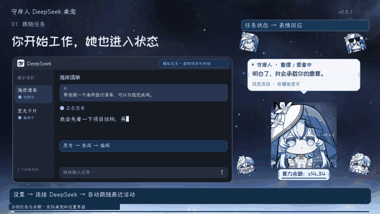

[横屏演示 · 1920×1080](https://github.com/Doya16/shorekeeper-deepseek-pet/releases/download/v0.5.1/shorekeeper-deepseek-landscape-v051-r2.mp4) · [竖屏演示 · 1080×1920](https://github.com/Doya16/shorekeeper-deepseek-pet/releases/download/v0.5.1/shorekeeper-deepseek-portrait-v051-r2.mp4)

视频及星空背景展示图沿用 **DeepSeek 独立版 v0.5.1** 的完整演示，时长 **03:17**；部分通用设置配图也沿用独立版，插件版完整设置截图列在下方。插件版保留其中的桌面功能，安装与启动请按下方步骤操作；视频中的创建桌面快捷方式不适用于插件版。**客户端窗口、对话、任务、余额和新版提醒为示例；桌宠与设置为实际界面。**

**v1.1.4 新增余额框显示开关：在「设置 → 字体与大小 → 余额框大小」旁勾选，或右键桌宠 / 余额框，在「刷新余额」下一项选择「隐藏余额框 / 显示余额框」。隐藏后不再为余额框留空，贴边和屏幕适配只计算角色范围，设置随配置保存和迁移。旧用户请先更新 Harness 插件，再在「设置 → 守岸人桌宠」点击「更新并重启守岸人」；进入新版后，也可直接在桌宠内一键更新程序。**

<p>
  
  
</p>

[设置中的显示开关](https://github.com/Doya16/dsh-shorekeeper/blob/v1.1.4/docs/images/balance-settings.png) · [右键菜单中的显示 / 隐藏选项](https://github.com/Doya16/dsh-shorekeeper/blob/v1.1.4/docs/images/balance-menu.png)

| 时间 | 展示内容 |
| --- | --- |
| 00:01 | 跟随任务，切换思考、查阅、编写等表情 |
| 00:30 | 多个会话分别完成提醒 |
| 00:50 | 单击、双击、拖动与其他桌面互动 |
| 01:06 | 悬停小锁、点击穿透与快捷静音 |
| 01:24 | 余额显示和点击刷新反馈 |
| 01:36 | 自选 GIF、播放规则、多语音与逐条字幕 |
| 02:14 | 桌宠大小、气泡、底栏与字体 |
| 02:31 | 启停联动、更新提醒与下载来源 |
| 02:53 | 保存配置与完整迁移 |
| 03:09 | 原独立版下载介绍；本插件安装见下文 |

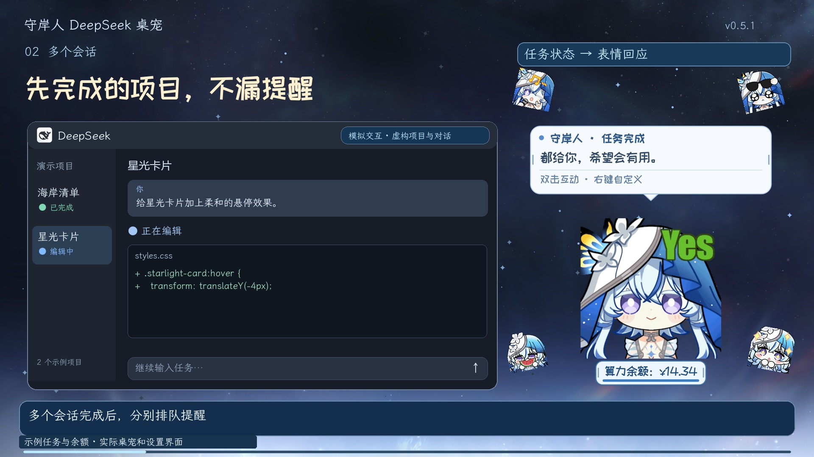

| 锁定、淡化与点击穿透 | 底部余额框刷新反馈 |
| --- | --- |
| 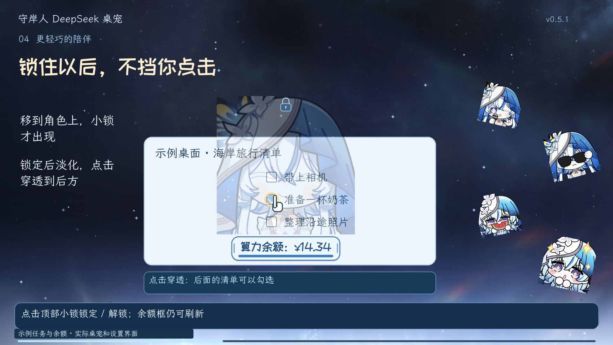 | 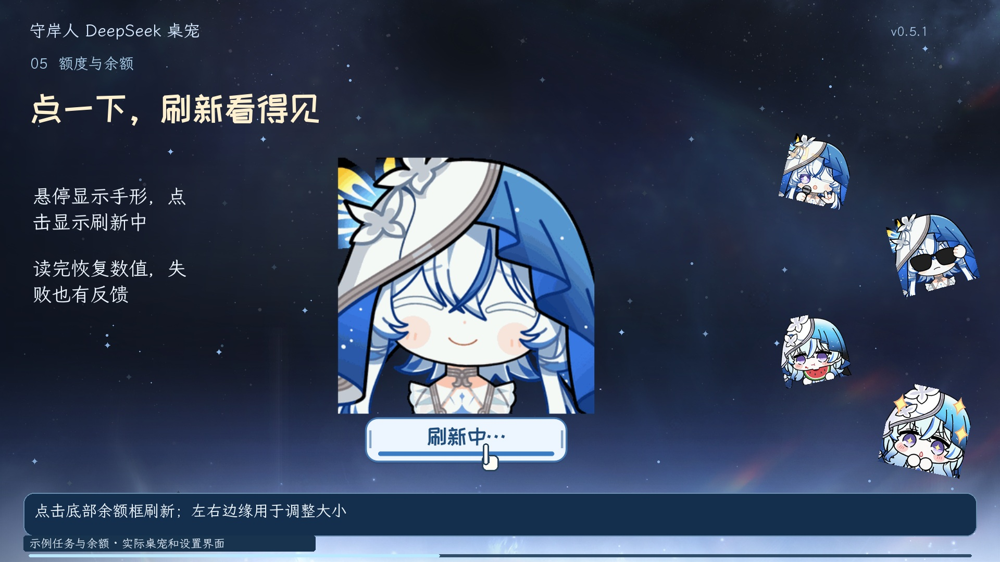 |

## 可以做什么

- **看任务状态**：思考、查阅、编写、执行、等你回应、完成、报错和暂停使用不同表情。多个会话完成后分别排队提醒，先完成的任务也有回应。
- **搭配语音与字幕**：一个动作添加多条音频，每条单独配台词，随机选择一对播放。气泡内容可选“自定义音频+字幕”，音频和字幕对应显示。
- **调整播报频率**：同一轮任务来回切换思考、查阅、编写时，开始语音可只播放一次；待机可选择每次进入、每次启动一次或偶尔播放，偶尔播放还可设置概率和最短间隔。
- **自由设置动画**：从三套表情中选择，或导入自己的素材；逐动作调整速度、循环、单次播放、播完停留时间和下一状态。
- **桌面互动**：摸头、双击、拖动、放下、悬停、投喂均可单独绑定 GIF、音频和气泡。
- **调整外观**：Ctrl + 滚轮缩放桌宠；解锁时拖动气泡或余额框左右边缘调整尺寸；字体、字号、气泡宽度和底栏大小可实时预览，之后随桌宠等比例缩放。
- **减少打扰**：一键“安静陪伴（静音）”；锁定后角色区域点击穿透，悬停时角色与余额框一起淡化，任务动画和提醒继续。
- **查看账户余额**：底部显示充值与赠送余额合计；点击刷新，悬停看明细。按金额显示，星号表示缓存，没有可用读数时显示 `--`。
- **跟随客户端**：可选择随 Harness 启动、完全退出时关闭，也可选择跟随的会话；托盘点击唤醒或隐藏。
- **保持更新**：启动或定时检查新版；无声气泡常驻提醒，一键下载程序更新并重启，保留当前搭配。支持今日不再提醒、GitHub / 镜像来源及中断恢复。
- **保存与换电脑**：修改自动保存，可导出配置素材包或包含运行程序的便携完整包。GIF、气泡文本、字体、音频、配对字幕和全部桌宠设置一起携带。

## 开始使用

1. 安装并登录 [DeepSeek Harness](https://www.deepseek.com/harness/)。本版验证环境为 **0.2.1-rc.5**。
2. 在 Harness 安装并启用 `dsh-shorekeeper`。
3. 点击窗口右下角 **守岸人桌宠 → 下载并安装完整版**。首次下载约 213 MiB，可选自动、GitHub 或镜像加速。
4. 点击 **启动桌宠**。右键桌宠 → **设置…**，或从插件入口点击 **打开完整设置**。

[社区收录申请 #158](https://github.com/polang233/dsh-plugin-index/issues/158) 已获收录。[npm 包](https://www.npmjs.com/package/dsh-shorekeeper) 名称为 `dsh-shorekeeper`，当前插件版本 `1.1.2`，可通过 Harness 桌面客户端的插件管理安装。插件入口小于 0.3 MB，首次启动完整桌宠另需下载约 213 MiB。市场的「已审查」标签绑定具体版本及哈希，新版需由维护者重新核对。

独立 npm CLI 的用户可向自己的非 `desktop` 配置安装，例如：

```powershell
dsh plugin --profile shorekeeper add dsh-shorekeeper@1.1.2
```

桌面客户端的 `desktop` 配置由客户端管理，不能用独立 npm CLI 直接修改。上面的 CLI 示例不会把插件装入桌面客户端。

安装后启用插件即可，无需另外安装旧版的连接插件。若同时运行原独立版，可能出现两只桌宠；按需要关闭其中一只。

## 部署后隐藏入口

首次安装并成功启动桌宠后，右下角的部署面板和「守岸人桌宠」按钮会一起自动隐藏，重启 Harness 后继续保持隐藏。面板内也可点击 **隐藏部署入口**。

以后在 **Harness 设置 → 守岸人桌宠** 启动、关闭、打开完整设置或更新完整版；点击 **显示部署入口** 可恢复右下角按钮。主动恢复后不会再次自动隐藏。隐藏入口不会关闭桌宠或停用任务状态连接。

## 一个窗口调整所有设置

右键桌宠或托盘 → **设置…**，在同一个窗口调整 **字体与大小、交互工作室、桌面与声音、保存与迁移、连接 DeepSeek、版本与更新**。也可点击 Harness 插件入口中的 **打开完整设置**。

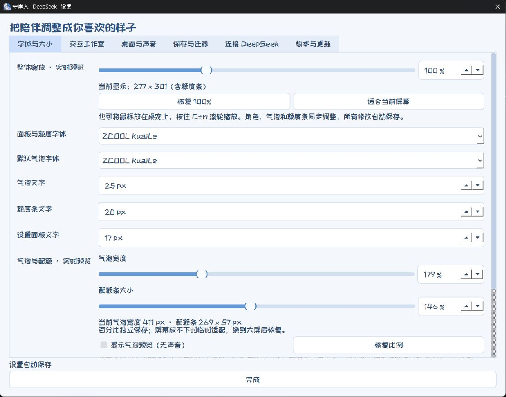

## 完整自定义

| 想做什么 | 在哪里操作 |
| --- | --- |
| 为每个动作选择 GIF、动态 WebP 或图片 | 设置 → 交互工作室 → GIF 素材 |
| 添加自己的表情并预览 | 导入图片，或打开素材目录 → 放入文件 → 刷新素材 |
| 调整循环、速度、单次播放与下一状态 | 交互工作室 → 播放与切换 |
| 同一动作随机播放多条音频，每条单独配字幕 | 交互工作室 → 语音与配对气泡 |
| 气泡只使用音频对应的字幕 | 气泡与字体 → 自定义音频+字幕 |
| 思考每轮只播一次；待机每次、每次启动一次或偶尔播报 | 交互工作室 → 语音与配对气泡 → 自动播报频率 |
| 字体、字号、气泡宽度、底栏大小与实时预览 | 设置 → 字体与大小 |
| 显示 / 隐藏余额框 | 余额框大小旁的勾选项，或右键 → 刷新余额下一项 |
| 静音、锁定淡化、小锁大小、托盘图标 | 设置 → 桌面与声音 |
| 保存、导入、导出素材和完整便携包 | 设置 → 保存与迁移 |
| 随 Harness 启动、退出；选择跟随的会话 | 设置 → 连接 DeepSeek |
| 启动检查更新、手动检查、选择网络来源 | 设置 → 版本与更新 |

先在交互工作室左侧选择一个动作，再为它选择表情、播放规则、气泡和语音。选择单次播放等模式后，不适用的数值框会灰色锁定并给出提示。

支持 GIF、动画 WebP、PNG、JPG/JPEG、静态 WebP；音频支持 WAV、MP3、OGG、FLAC、M4A、AAC；字体支持 TTF、OTF、TTC。同名 UTF-8 TXT 可随音频导入为台词。不添加音频也能使用。

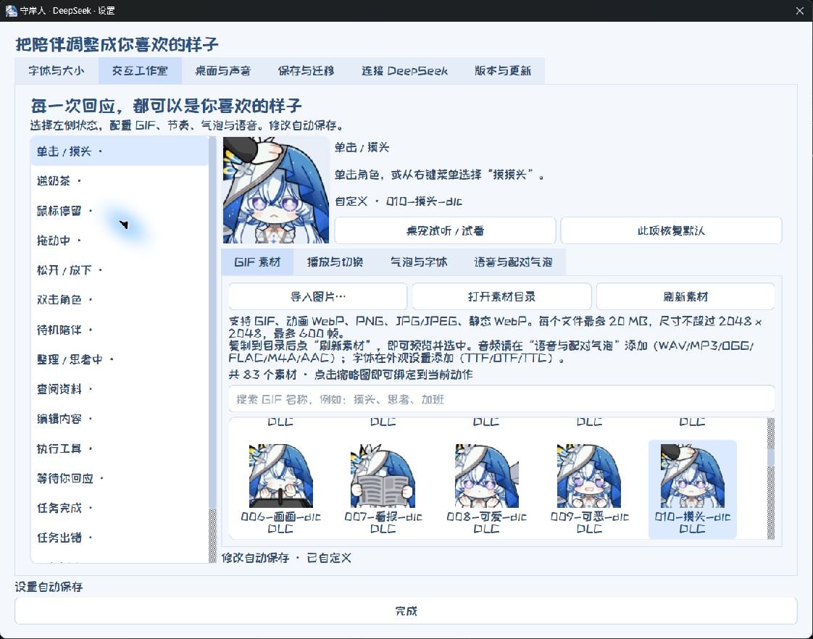

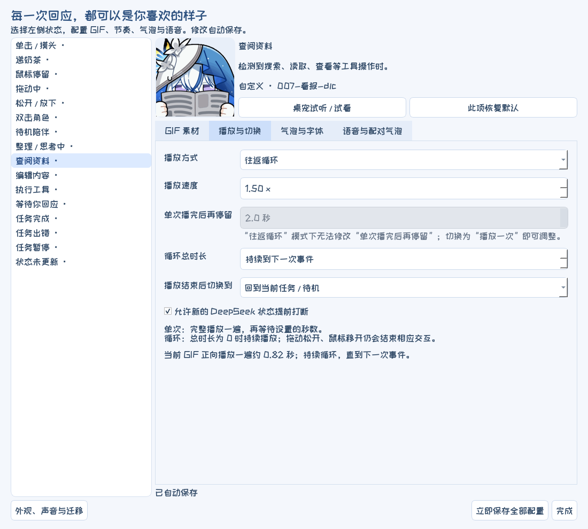

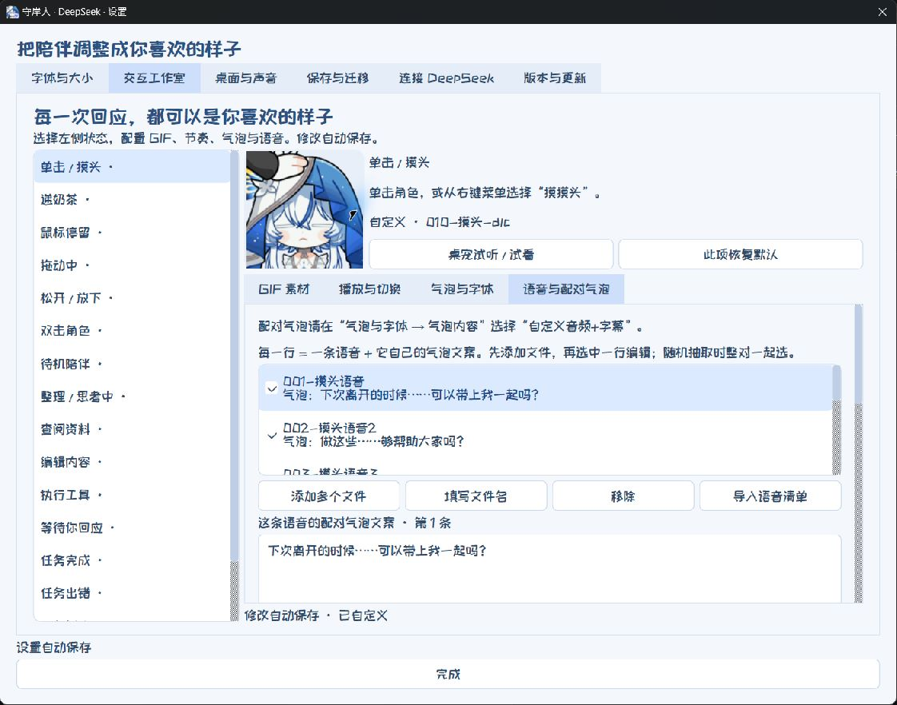

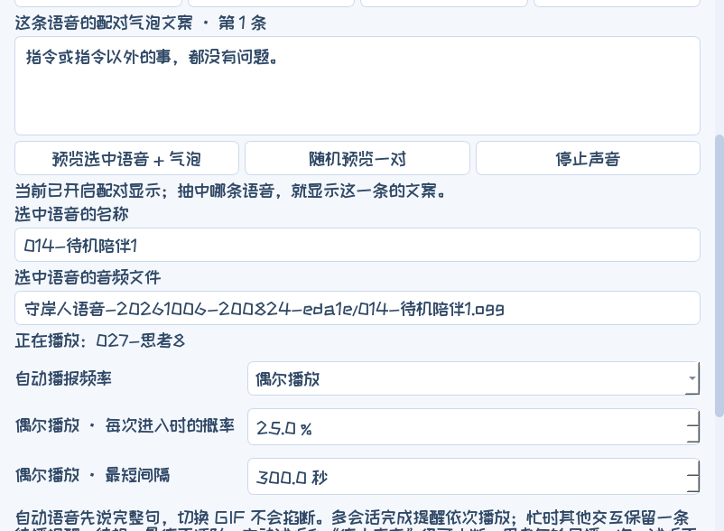

## 大小、气泡与字体

在 **设置 → 字体与大小** 调整桌宠整体大小、气泡与余额条尺寸。可分别设置面板与额度字体、默认气泡字体及字号，单个动作也可单独指定字体。

已内置 **站酷快乐体、霞鹜文楷**，可以添加自己的本地字体文件。气泡文字自动换行，内容较长时向下延伸；选择“自定义音频+字幕”后，气泡显示本次选中音频对应的台词。

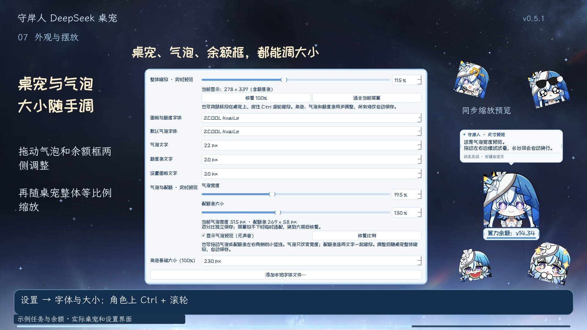

## 静音、锁定与余额刷新

- **安静陪伴（静音）**：右键菜单一键停止当前和待播声音，同时暂停自动播报与试听；取消后恢复原音量，不补播静音期间的声音。
- **顶部小锁**：鼠标移到角色上时显示，点击即可锁定或解锁；移开鼠标后隐藏，悬停显示“点击锁定”或“点击解锁”。
- **锁定穿透**：点击角色区域可操作后面的窗口；悬停角色或余额框时，两者按设置一起淡化。小锁仍可解锁，余额框仍可点击刷新；锁定时暂停拖动与拖边缩放。
- **透明度和锁大小**：在 **设置 → 桌面与声音** 调整。小锁大小随桌宠整体等比例缩放。
- **显示 / 隐藏余额框**：右键桌宠或余额框，在“刷新余额”下一项切换；设置中也可在余额框大小旁勾选。隐藏后不留底部空白，也没有隐藏的点击区域；任务动画、气泡、语音和手动刷新继续可用。再次显示时恢复原来的尺寸，隐藏状态自动保存并随配置迁移。
- **余额刷新**：鼠标移到框内显示手形，点击后框内显示 **刷新中…**。成功后恢复最新数值；失败时短暂显示 **刷新失败**，随后保留最近读数。重复点击不会叠加请求。
- **关闭程序**：右键菜单选择 **关闭守岸人**。也可从 Harness 的桌宠入口关闭。

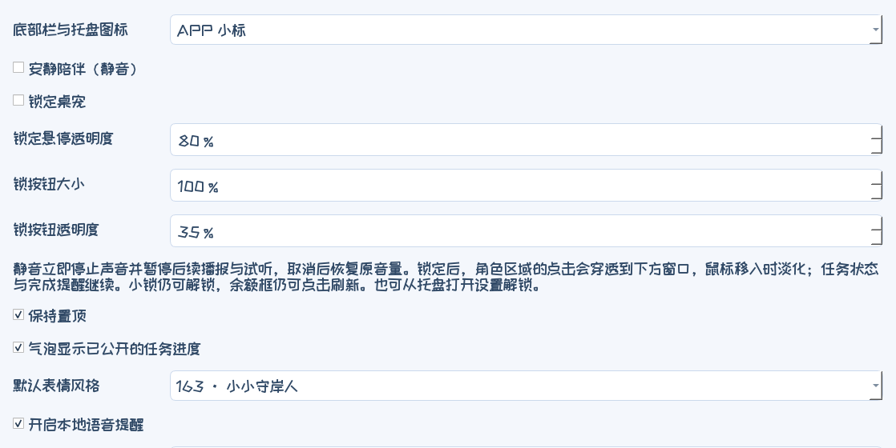

## 图标、声音与托盘

- 默认图标在守岸人右下角显示 DeepSeek 蓝色鲸鱼小标，与 Codex 版的黑白 GPT 小标区分。
- 在 **设置 → 桌面与声音 → 底部栏与托盘图标** 选择 **纯净图标 / APP 小标**，立即生效，选择随配置保存和迁移。
- 音量合成器显示 **守岸人 · DeepSeek**，可以单独调节音量。
- 托盘提示 **守岸人 · DeepSeek · 点击唤醒/隐藏**，点击切换桌宠显示状态。

## 随 Harness 启动与关闭

在 **设置 → 连接 DeepSeek** 中分别勾选 **随 DeepSeek 启动桌宠** 和 **随 DeepSeek 完全退出而关闭**。同时启用 Harness 中的本插件，才会随客户端启动桌宠。

客户端关闭窗口后如果仍在托盘运行，桌宠继续陪伴；完全退出后关闭桌宠。可取消退出联动，让桌宠继续留在桌面。连接设置也可以选择自动跟随最近活动的会话，或固定跟随某个会话。

## 检查更新与保留配置升级

当前插件与完整程序版本均为 **v1.1.4**。本次功能位于完整程序中：先更新 Harness 插件，再到 Harness「设置 → 守岸人桌宠」点击“更新完整版”。个人配置、GIF、语音、字幕和字体会保留；旧配置默认继续显示余额框。右键 → **设置 → 版本与更新**，可开启或关闭完整程序的启动检查、立即检查更新，或恢复已忽略版本的提醒。新版提示支持稍后提醒和忽略此版本；网络检查失败不会打断桌宠。

更新来源可选 **自动选择 / GitHub 官方源 / 镜像加速**。自动模式先尝试 GitHub，连接失败时切换 [GH-Proxy](https://gh-proxy.org/)；也可手动固定来源。镜像可能有同步延迟，可切回 GitHub 检查。

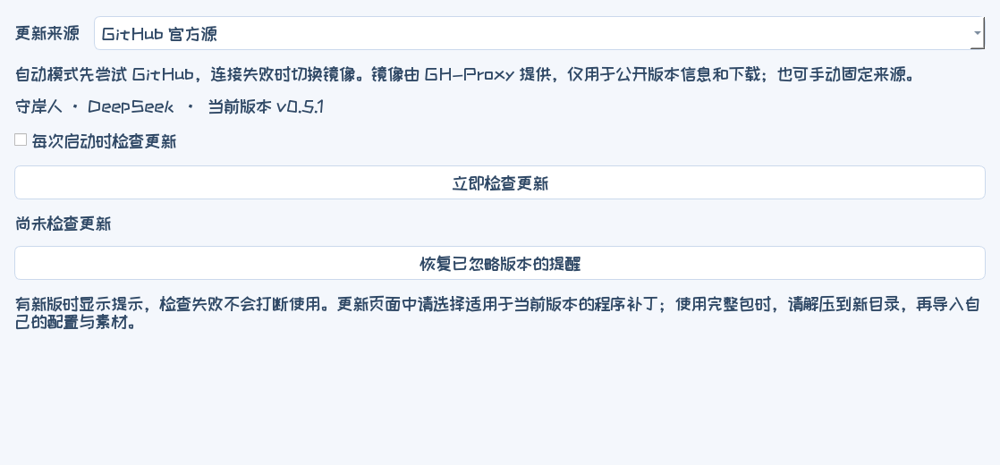

| 当前情况 | 如何操作 |
| --- | --- |
| 首次安装本插件 | 在 Harness 安装并启用插件，点击入口的“下载并安装完整版”，完成后启动 |
| 已使用本插件，有新版本 | 更新 Harness 中的插件；在 Harness「设置 → 守岸人桌宠」看到完整程序新版时，点击“更新完整版” |
| 原独立版用户迁入 | 在原版导出配置素材 ZIP，安装本插件后，在“设置 → 保存与迁移”导入 |

更新提醒不会自动安装程序。完整程序更新会保留个人设置、GIF、音频、字体和导出文件，并留下上一份程序目录供恢复。桌宠内的更新入口指向本插件仓库，原独立版继续通过自己的仓库更新。

## 保存与换电脑

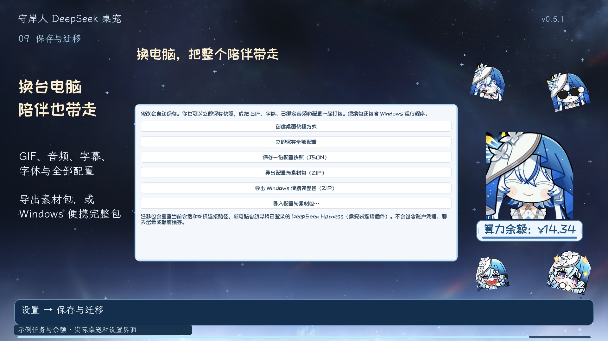

设置自动保存。请在 **设置 → 保存与迁移** 导出：

- **配置与素材包**：GIF、图片、全部音频、配对字幕、字体和设置。
- **Windows 便携完整包**：上述内容加运行程序，可在新电脑解压使用。

原独立版导出的 ZIP 可以直接导入。换电脑后安装并登录 Harness、启用本插件，再导入自己的配置包。账号登录和聊天记录不会进入桌宠导出包。

插件下载的完整桌宠与个人素材保存在 Harness 数据目录的 `shorekeeper-market/app` 中，位于插件安装目录之外。**升级或卸载插件不会删除这份配置**。更新完整程序时会保留个人设置、GIF、音频、字体和导出文件，并留下上一份程序目录供恢复。

也可导入 Codex 版的配置素材包，继续使用自己的表情、声音、字幕和字体。新电脑需要安装并登录 Harness、启用本插件，连接路径会重新适配。

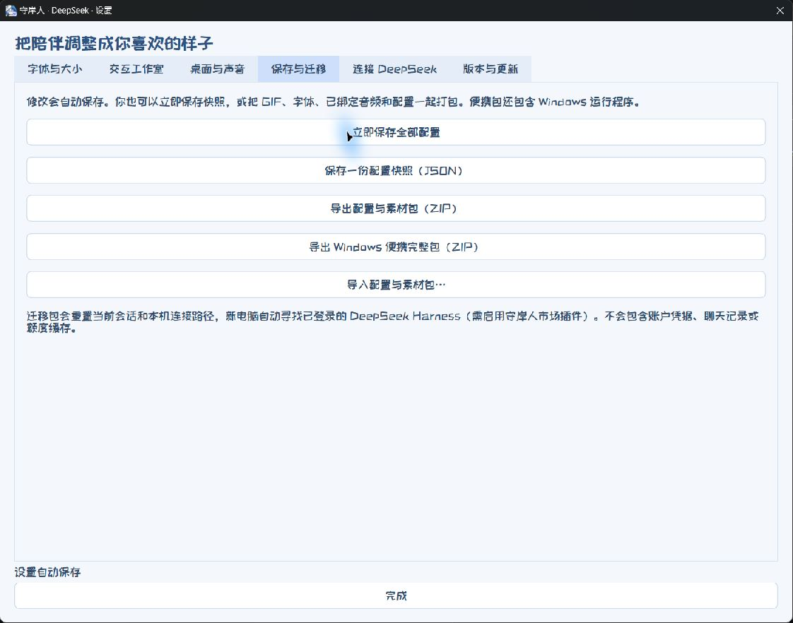

## 适用范围与验证

- 面向 **Windows 10/11 x64 本机 DeepSeek Harness**；普通 DeepSeek 聊天网页、macOS、Linux 和远程服务器不在本版支持范围。
- 验证环境为官方 Harness **0.2.1-rc.5**；安装插件后新开始的任务会出现在会话列表，以“DeepSeek 会话”编号显示。
- “思考”表示任务处理阶段；气泡展示你设置的台词、字幕或已公开的任务进度。
- 完整程序的实际任务、账户余额和迁移验证，以及本次入口交互测试的具体范围，见 [测试记录](https://github.com/Doya16/dsh-shorekeeper/blob/v1.1.4/docs/VALIDATION.md)。
- 首次下载完整程序约 213 MiB，无需 Python。下载完成会校验固定 SHA-256；数据与运行范围见 [说明](https://github.com/Doya16/dsh-shorekeeper/blob/v1.1.1/docs/SECURITY.md)。

## 素材来源与感谢

表情包来自 [鸣潮表情包站](https://emoji.wuwa.games/)。表情包众筹 QQ 群：**1079834905**。

本项目 [Logo / 插件图标](https://github.com/Doya16/dsh-shorekeeper/blob/v1.1.2/icon.png) 使用默认守岸人形象与底部配额框的实际界面截图；其中“算力配额：1145.14”为展示用模拟值。角色与表情包权利归原权利人所有。项目为非官方社区插件。

感谢所有为该项目表情包众筹投资的守岸人厨子们。

程序代码采用 [MIT](https://github.com/Doya16/dsh-shorekeeper/blob/main/LICENSE)；角色、表情包、语音与字体遵循各自的许可，详见 [素材说明](https://github.com/Doya16/dsh-shorekeeper/blob/v1.1.1/CREDITS.txt) 和 [第三方说明](https://github.com/Doya16/dsh-shorekeeper/blob/v1.1.1/desktop/THIRD_PARTY.txt)。

## 开发与验证

完整环境、源码提交记录、打包产物及发布校验见 [构建说明](https://github.com/Doya16/dsh-shorekeeper/blob/v1.1.2/docs/BUILD.md)。

```powershell
npm test
python -m pip install -r desktop/tools/requirements-build.txt
cd desktop
python -m unittest discover -s tests
cd ..
python desktop/tools/build_portable.py
python tools/package-runtime.py
npm pack
```

`desktop/` 是完整版源代码和默认素材；`lib/` 是 Harness 连接与启动入口。上游版本记录在 [UPSTREAM.json](https://github.com/Doya16/dsh-shorekeeper/blob/v1.1.1/desktop/UPSTREAM.json)。构建出的程序和 ZIP 不提交到 Git，发布为 Release 附件。
